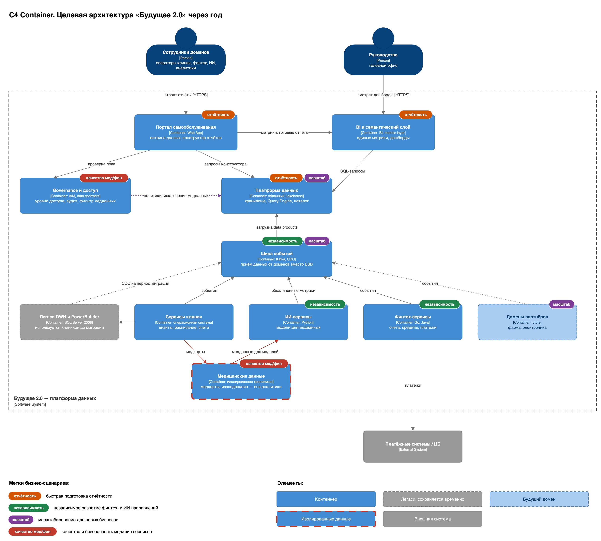

# Task 1. Целевая архитектура и приоритизация проблем

## Целевая архитектура (C4, контейнеры)

Исходник диаграммы: [`C4-container-target.drawio`](C4-container-target.drawio).

Сейчас всё держится на монолитном DWH на SQL Server 2008. В нём лежат данные всех направлений и бизнес-логика. Поэтому любой новый отчёт или новый бизнес требует новых трансформаций внутри DWH. Из-за этого растёт time-to-market, отчёты строятся часами, а направления не могут развиваться независимо.

Целевое состояние через год — **Data Mesh на облачной платформе**. Данными владеют домены, а не центральная команда DWH. Общая платформа даёт доменам единый инструментарий. Бизнес-пользователь получает отчёты через **портал самообслуживания** в пределах своего уровня доступа.

### Как архитектура поддерживает бизнес-сценарии

| Бизнес-сценарий | Чем обеспечивается |
|---|---|
| Быстрая подготовка отчётности | Домены заранее и инкрементально готовят data products из своих событий, поэтому отчёт не пересчитывает данные из сырых таблиц каждый раз. Запросы выполняет колоночный движок (Trino/ClickHouse) на облачных вычислениях, которые масштабируются под нагрузку, а не один SQL Server 2008. Метрики считаются один раз в семантическом слое и переиспользуются всеми отчётами. |
| Независимое развитие финтех- и ИИ-направлений | У финтеха и ИИ свои домены: сервисы и собственный data product. Команды релизятся независимо и не трогают общий DWH. |
| Масштабирование для новых бизнесов | Домен партнёра подключается так же, как существующие: свой data product, публикация на платформу по общим контрактам. Облачная платформа масштабируется под объём данных. |
| Качество медицинских и финансовых сервисов | Медданные изолированы внутри домена клиники и на платформу не попадают. Доступ и контракты задаёт федеративное управление. |

## Анализ проблемных мест

| Проблема | Затрагиваемый бизнес-сценарий | Бизнес-последствие |
|---|---|---|
| **Отчёты строятся часами.** Сотни ТБ в одном DWH, огромное число трансформаций на каждый отчёт | Подготовка управленческой и операционной отчётности | Задержки в принятии управленческих решений; аналитика не успевает за бизнесом |
| **Бизнес-логика «зашита» в DWH.** Логика финтеха и ИИ реализована поверх хранилища | Независимое развитие финтех- и ИИ-направлений | Любая доработка направления требует изменения общего DWH; команды блокируют друг друга, падает time-to-market |
| **Монолитное хранилище без границ доменов.** Все данные (клиенты, финансы, кредиты, HR, инвентаризация, медицина) в одной системе | Масштабирование для новых бизнесов (фарма, электроника) | Подключение нового направления требует вмешательства в ядро; стоимость и риск каждого расширения растут |
| **SQL Server 2008 устарел и не поддерживается.** EOL, не масштабируется горизонтально | Все сценарии работы с данными; надёжность сервисов | Технические и лицензионные риски, потолок производительности, уязвимости без патчей |
| **Интерфейс операторов на PowerBuilder.** Узкий рынок специалистов, дорогая поддержка | Операционная работа клиник | Высокая стоимость сопровождения, риск остановки при уходе разработчиков |
| **Power BI с большим числом кастомизаций поверх DWH** | Подготовка отчётности, самообслуживание | Отчёты хрупкие и трудно воспроизводимые; нельзя дать пользователям безопасное самообслуживание |
| **Старая шина ESB (Apache Camel) — единственный интеграционный слой** | Интеграция новых сервисов и партнёров | Жёсткая связность, сложно добавлять источники и потребителей; интеграции становятся узким местом при росте |
| **Нет разграничения доступа по уровням и аудита.** Доступ к мед- и фин-данным не управляется централизованно | Качество и безопасность мед/фин сервисов, комплаенс | Риск утечки медицинских и финансовых данных, штрафы регуляторов, потеря доверия |
| **Медицинские данные не отделены от аналитического контура.** Медкарты, истории болезней и исследования лежат в том же DWH | Витрина данных (по условию медданные в неё не входят) | Риск попадания особо чувствительных данных в отчёты; нарушение требований к обработке медданных |
| **Нет каталога данных и data lineage** | Самообслуживание, доверие к отчётности | Пользователи не находят нужные данные и не доверяют цифрам; витрины дублируются |
| **Нет облачной отказоустойчивости.** Нет резервирования и гео-распределения для критичных систем | Надёжность финансовых и медицинских сервисов | Простои критичных сервисов ведут к прямым финансовым и репутационным потерям |

## Приоритизация проблем

### MoSCoW

В скобках — цель бизнеса, на которую влияет проблема.

| Must have — без этого цели года недостижимы | Should have — важно, но допускает поэтапность |
|---|---|
| **Логика в DWH** (time-to-market, независимость направлений) — корень проблемы, без выноса логики портал не заработает **Отчёты строятся часами** (скорость принятия решений) — витрину данных затевают именно ради этого **Медданные в аналитическом контуре** (качество мед сервисов, комплаенс) — жёсткое требование задания и регуляторный риск **Нет разграничения доступа и аудита** (качество мед/фин сервисов, комплаенс) — без него портал к мед/фин данным открывать нельзя **Монолит без границ доменов** (масштабирование, time-to-market) — без границ доменов нельзя разделить систему | **Старая ESB** (масштабирование, time-to-market) — замена на стриминг/CDC идёт поэтапно по доменам **SQL Server 2008** (снижение затрат и рисков) — допустим период сосуществования (strangler) **Нет облачной отказоустойчивости** (качество фин/мед сервисов, выручка) — вводится по мере переезда в облако |
| **Could have — полезно, можно позже** | **Won't have — в горизонте года не делаем** |
| **Кастомизации Power BI** (скорость принятия решений) — уходят сами с появлением семантического слоя **Нет каталога и lineage** (скорость принятия решений) — разворачивается после первых data products | **Интерфейс на PowerBuilder** (снижение затрат) — UI операторов можно оставить на время трансформации, легаси в доменах временно допустимо |

### Матрица Эйзенхауэра

Оси: **важность** (влияние на цели бизнеса) × **срочность** (насколько проблема блокирует ближайшие шаги трансформации).

| | Срочно | Не срочно |
|---|---|---|
| **Важно** | Бизнес-логика финтеха и ИИ находится внутри DWH Отчёты по сотням ТБ данных строятся часами Нет разграничения доступа к мед- и фин-данным и нет аудита Медкарты и исследования лежат в одном хранилище с аналитическими данными | Все данные компании лежат в одном хранилище без деления на домены DWH работает на неподдерживаемом SQL Server 2008 Интеграции идут через устаревшую шину ESB на Apache Camel У критичных систем нет резервирования и гео-распределения |
| **Не важно** | Отчёты в Power BI держатся на множестве ручных кастомизаций Нет каталога данных и не видно, откуда берутся данные в отчётах | Интерфейс операторов клиник написан на PowerBuilder |

### Вывод

Критичный путь трансформации:

1. вынести логику из DWH;
2. задать границы доменов;
3. поднять self-serve платформу данных;
4. закрыть разграничение доступа и изолировать медданные;
5. дать быструю отчётность через портал.

Такой порядок работает на скорость решений, time-to-market за счёт независимых доменов, качество мед/фин сервисов и масштабирование под фарму и электронику.
