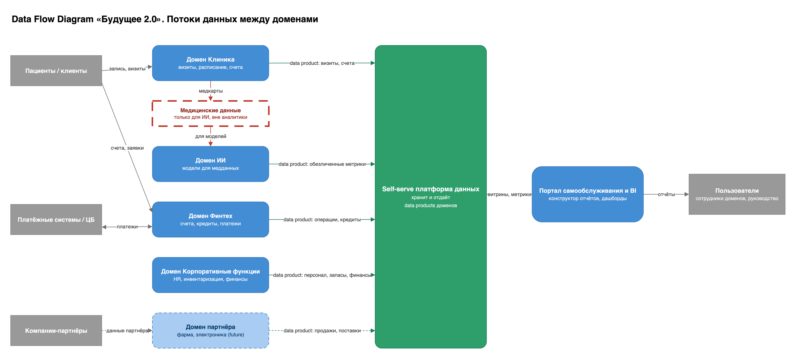

# Task 2. Разделение на домены и потоки данных

## Потоки данных между доменами (DFD)

Исходник диаграммы: [`DFD-domains.drawio`](DFD-domains.drawio).

Каждый домен владеет своими данными и сам публикует их на общую self-serve платформу в виде data product. Бизнес-логика остаётся внутри домена. Платформа только хранит и отдаёт данные, поэтому новая логика в хранилище не появляется. Медицинские данные остаются в отдельном хранилище: им пользуются только ИИ-сервисы, на платформу они не попадают.

## Домены

| Домен | Зона ответственности | Что публикует на платформу | Для какого бизнеса нужен |
|---|---|---|---|
| Клиника | Визиты, расписание, счета за услуги, работа операторов | Визиты и счета без медданных | Клиники — основной источник выручки |
| ИИ | Модели для анализа медицинских данных | Обезличенные метрики моделей | ИИ-направление |
| Финтех | Счета, кредиты, платежи по банковской лицензии | Операции и кредитный портфель | Финтех-направление |
| Корпоративные функции | Персонал, инвентаризация, финансовая отчётность | Данные по персоналу, запасам и финансам | Головной офис |
| Партнёр (будущий) | Данные фармацевтических компаний и производителя электроники | Продажи, поставки, данные устройств | Новые бизнесы экосистемы |

Медицинские карты, истории болезней и результаты исследований не выделены в отдельный домен. Они остаются внутри клиники в изолированном хранилище: по условию задачи эти данные не используются для аналитики.

## Как бизнес-сценарии обеспечены потоками данных

| Бизнес-сценарий | Потоки данных на диаграмме |
|---|---|
| Интеграция нового финтех-сервиса | Новый сервис добавляется внутри домена Финтех. Наружу он отдаёт данные через тот же data product финтеха, поэтому платформа, портал и другие домены не меняются. |
| Использование ИИ для анализа медицинских данных | Клиника передаёт медкарты в изолированное хранилище, ИИ-сервисы берут данные оттуда. На платформу ИИ публикует только обезличенные метрики моделей. |
| Подключение партнёра (фарма, электроника) | Партнёр получает свой домен. Его данные приходят в домен и публикуются на платформу как ещё один data product, по тем же правилам, что у существующих доменов. |
| Отчётность по всей компании | Портал и BI читают data products всех доменов с платформы. Отчёт собирается из готовых данных, а не из общего DWH. |

## Почему система разделена именно так

Границы доменов проведены по направлениям бизнеса: клиники, ИИ, финтех, головной офис, будущие партнёры. У каждого направления свои команды, свой стек и свой темп изменений. Если делить систему по техническим слоям (интеграция, хранилище, отчёты), изменения любого направления снова будут проходить через общие компоненты, как сейчас через DWH.

Преимущества для бизнеса:

| Преимущество | За счёт чего |
|---|---|
| Ускорение вывода продуктов | Команда домена меняет свои сервисы и data product сама, без согласования изменений в общем DWH и без очереди к центральной команде. |
| Снижение зависимости от DWH | Логика и данные живут в доменах. Легаси-DWH остаётся только у клиники до миграции и больше не блокирует другие направления. |
| Отдельное развитие направлений | Финтех и ИИ развиваются в своём темпе и на своём стеке (Go/Java и Python). Сбой или релиз одного домена не останавливает остальные. |
| Масштабирование на новые бизнесы | Новый партнёр подключается как ещё один домен по стандартной схеме, поэтому стоимость и срок подключения предсказуемы. |
