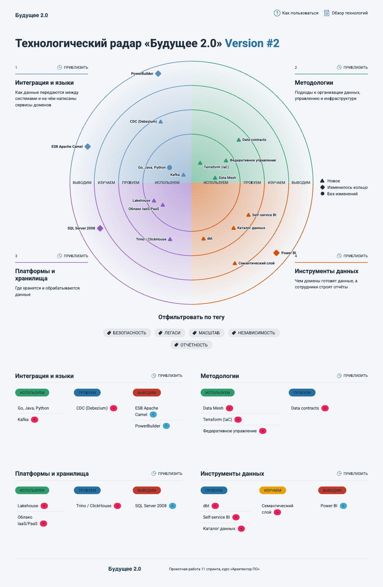
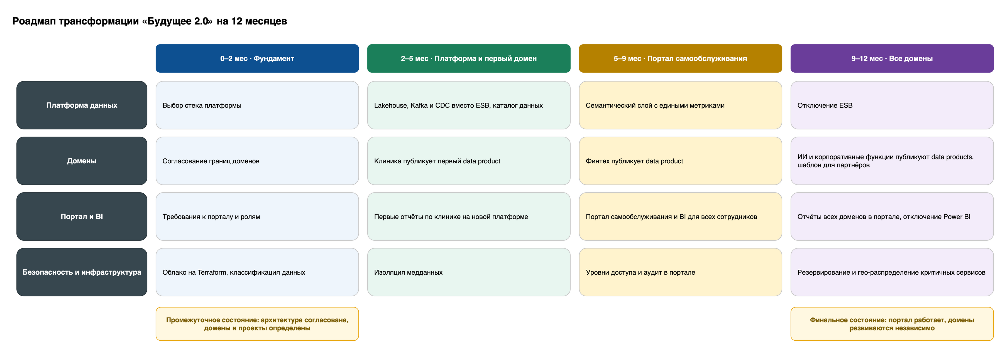

# Task 3. Технологический радар и роадмап

## Технологический радар



Радар собран на [AOE Technology Radar](https://github.com/AOEpeople/aoe_technology_radar) из исходников в [`tech_radar/`](tech_radar).

Запуск:

```bash
cd Task3/tech_radar
npm install
npm run build
npm run serve   # http://localhost:3000
```

| Технология | Кольцо | Текущая или новая | Какой бизнес-сценарий поддерживает |
|---|---|---|---|
| Облако IaaS/PaaS | Adopt | Новая | Масштабирование ресурсов под отчётность и новые бизнесы, отказоустойчивость критичных сервисов |
| Lakehouse | Adopt | Новая | Быстрая отчётность: дешёвое хранение сотен ТБ и аналитические запросы по ним |
| Kafka | Adopt | Новая | Домены публикуют события независимо друг от друга, без общей шины |
| Go, Java, Python | Adopt | Текущая | Существующий стек финтеха и ИИ сохраняется, команды не переучиваются |
| Data Mesh | Adopt | Новая | Независимое развитие направлений и подключение новых бизнесов как отдельных доменов |
| Федеративное управление | Adopt | Новая | Единые правила доступа к мед- и фин-данным при самостоятельных доменах |
| Terraform (IaC) | Adopt | Новая | Одинаковые облачные среды для каждого домена, быстрый запуск новых |
| Trino / ClickHouse | Trial | Новая | Быстрые отчёты: колоночный движок вместо SQL Server |
| CDC (Debezium) | Trial | Новая | Данные из легаси DWH клиники попадают на платформу без доработки самого DWH |
| Data contracts | Trial | Новая | Домены меняют свои системы, не ломая отчёты и другие домены |
| dbt | Trial | Новая | Домены сами и воспроизводимо собирают свои data products |
| Каталог данных | Trial | Новая | Сотрудник находит нужные данные в портале и видит, откуда они взялись |
| Self-service BI | Trial | Новая | Портал самообслуживания: сотрудники строят отчёты без аналитиков |
| Семантический слой | Assess | Новая | Одна и та же метрика одинаково считается во всех отчётах |
| SQL Server 2008 | Hold | Текущая | Остаётся операционной БД клиники до миграции, новая логика в нём не появляется |
| ESB Apache Camel | Hold | Текущая | Заменяется Kafka и CDC |
| PowerBuilder | Hold | Текущая | Интерфейс операторов клиник остаётся на время трансформации, развитие не ведётся |
| Power BI | Hold | Текущая | Заменяется self-service BI и семантическим слоем |

## Роадмап



Исходник: [`roadmap.drawio`](roadmap.drawio).

| Этап | Что делаем | Результат | Команды | Ресурсы | Зачем бизнесу |
|---|---|---|---|---|---|
| **0–2 мес · Фундамент** | Согласуем целевую архитектуру и границы доменов, разворачиваем облако на Terraform, классифицируем данные и задаём политики доступа | Промежуточное состояние: архитектура согласована, домены и проекты витрины данных определены | Архитекторы, платформенная команда, информационная безопасность | Облачный аккаунт, архитектор, одна платформенная команда, специалист по ИБ | Без согласованных границ доменов новые изменения продолжат оседать в DWH. Этап снимает этот риск до начала основных работ |
| **2–5 мес · Платформа и первый домен** | Поднимаем Lakehouse, Kafka и CDC вместо ESB, каталог данных. Клиника публикует первый data product, медданные изолируются | Платформа работает, первые отчёты по клинике строятся на ней, а не в DWH | Платформенная команда, data-инженеры, команда клиники | Облачные хранилище и вычисления, data-инженеры | Подход проверяется на главном источнике выручки. Интеграции перестают зависеть от устаревшей ESB |
| **5–9 мес · Портал самообслуживания** | Запускаем портал и BI с семантическим слоем, включаем уровни доступа и аудит. Финтех публикует data product | MVP витрины данных: сотрудники сами строят отчёты в пределах своего доступа | BI-команда, платформенная команда, ИБ, команда финтеха | BI-команда, владелец продукта портала | Решения принимаются быстрее, потому что отчёт больше не ждёт аналитиков и ночных пересчётов. Разграничение доступа закрывает регуляторные риски по мед- и фин-данным |
| **9–12 мес · Все домены** | ИИ и корпоративные функции публикуют data products, готовим шаблон подключения партнёров, отключаем ESB и Power BI, настраиваем резервирование и гео-распределение критичных сервисов | Финальное состояние: портал покрывает все направления, домены развиваются независимо. Легаси DWH и PowerBuilder остаются только у клиники | Команды всех доменов, платформенная команда, ИБ | Команды доменов, миграционная команда | Финтех и ИИ выпускают изменения без общего DWH. Фарму и электронику можно подключить по готовому шаблону. Поддержка ESB и Power BI больше не нужна, затраты снижаются |
