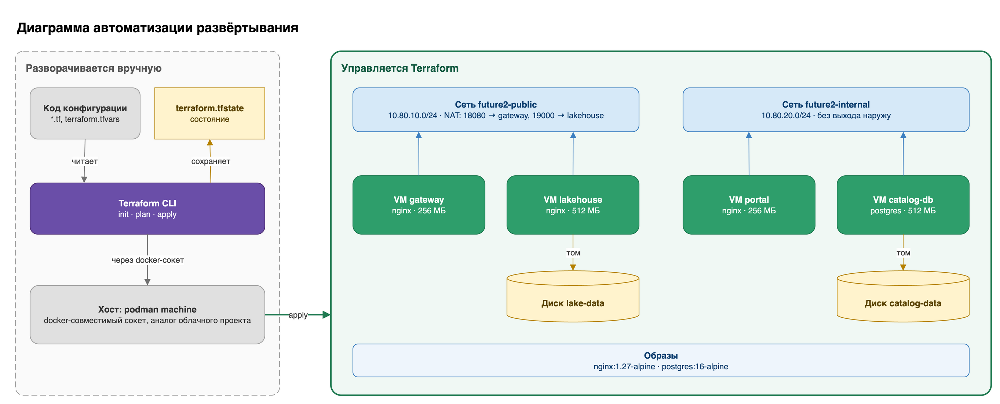
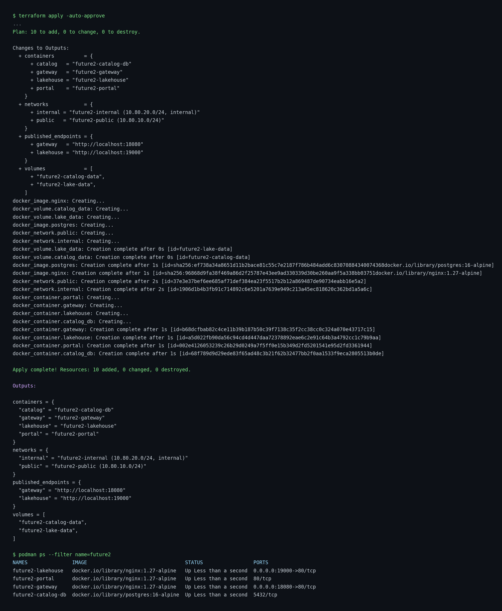

# Task 4. Облачная инфраструктура (IaaS, Terraform)

## Диаграмма автоматизации развёртывания



Вручную готовятся только код конфигурации и хост, на котором создаются ресурсы. Сети, диски, образы и виртуальные машины создаёт Terraform. Локально облако смоделировано Docker-провайдером через сокет podman machine: контейнер играет роль VM, том — диска, bridge-сеть — сети, публикация порта — NAT.

Конфигурация: [`main.tf`](main.tf), [`variables.tf`](variables.tf), [`outputs.tf`](outputs.tf), [`terraform.tfvars`](terraform.tfvars). Обоснование выбора ресурсов и параметров — в [`justification.md`](justification.md).

## Результат terraform apply



## Запуск

```bash
cd Task4
terraform init
terraform plan
terraform apply
terraform destroy   # удалить созданные ресурсы
```

`docker_host` в `terraform.tfvars` указывает на сокет podman machine на этой машине. На другой машине его нужно заменить на свой путь (`podman machine inspect --format '{{.ConnectionInfo.PodmanSocket.Path}}'`) или на `unix:///var/run/docker.sock` для Docker Desktop.
